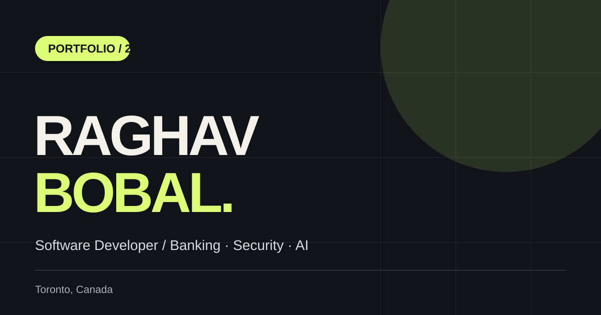

# Raghav Bobal
### Software Developer · Banking Systems · Security · Applied AI

[](https://raghavbobal1.github.io/portfolio-website-latest/)

**[Explore the portfolio](https://raghavbobal1.github.io/portfolio-website-latest/)** · [LinkedIn](https://www.linkedin.com/in/ACoAAC4Bcc0BImTOCM6A_5gzhyzdk9VVMSNhSLc) · [GitHub](https://github.com/raghavbobal1)

A personal corner of the web built to show how I approach software engineering: building reliable banking experiences, solving security and production problems, and exploring practical AI systems.

## Take a look around

- **Selected work:** Expandable case studies covering payments, digital banking, security and AI projects.
- **System explorer:** Interactive views of banking, security and AI architectures.
- **Engineering Score:** A replayable debugging game with 30 randomized Java, API, security, cloud and AI scenarios, shuffled answers, streak bonuses and explanations.
- **My journey:** Experience at BMO and Beacontree, research at Lambton College, and my education.
- **Quick navigation:** Keyboard shortcuts, responsive layouts and accessible interactions.

## Projects with source code

- [Payment reliability API (Java 21 / Spring Boot)](labs/payment-reliability-api/) — a simulated transfer API with idempotent requests, concurrency checks and eight passing JUnit tests. It's a local demo, not a real payment system.
- [Bobal Android app](bobal-language-learning-app.html) — archived language-learning project with original screenshot.

## Hiring & search

- [Software developer in Toronto — experience and hiring profile](hire-software-developer-toronto.html)
- [Bobal Android language-learning case study](bobal-language-learning-app.html)
- [Search Console and optional analytics setup](docs/SEO-ANALYTICS.md)

The portfolio includes SEO metadata, profile structured data, and a sitemap. Visitor analytics is **not enabled** until a GA4 Measurement ID is configured. When enabled, the site asks for consent before loading Google's analytics script.

## Built with

**HTML · CSS · JavaScript**

No heavy frontend framework is required. The portfolio uses custom visuals, lightweight interactions and responsive layouts. There's no backend to configure.

## Run it locally

```bash
git clone https://github.com/raghavbobal1/portfolio-website-latest.git
cd portfolio-website-latest
python3 -m http.server 8000
```

Open **http://localhost:8000**. You can also open `index.html` directly.

## Behind the scenes

- `index.html` — content and page structure
- `styles.css` — visual design and responsive styling
- `script.js` — interactions, project panels and challenges
- `tests/` — lightweight site checks
- `docs/` — [deployment notes](docs/DEPLOYMENT.md) and [project documentation](docs/PROJECTS.md)

Run the checks with:

```bash
python3 -m unittest discover -s tests -v
node --check script.js
```

---

**Based in Toronto, Canada.** Open to software engineering opportunities across backend, full-stack and AI-enabled applications.

**[Visit the website](https://raghavbobal1.github.io/portfolio-website-latest/)** · **[Get in touch](mailto:raghavbobal10@gmail.com)**
